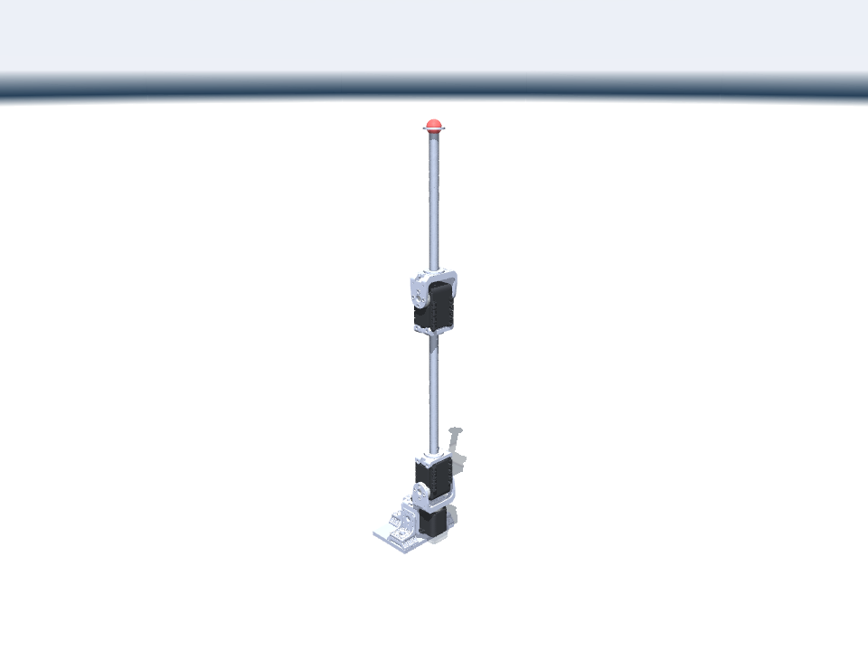
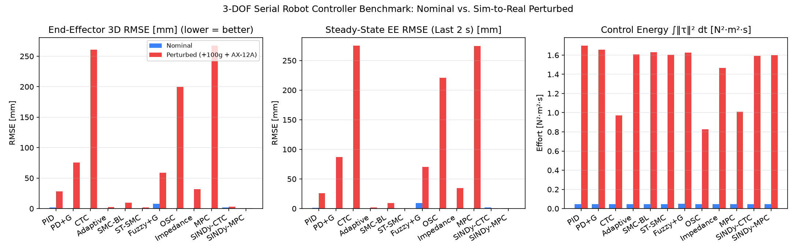
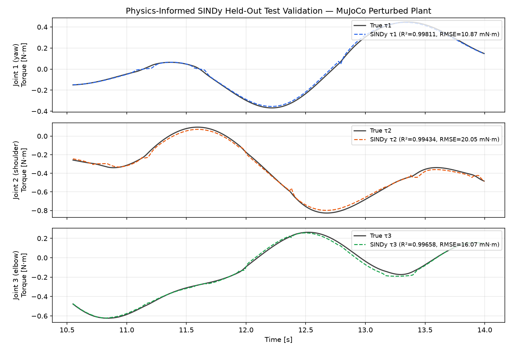
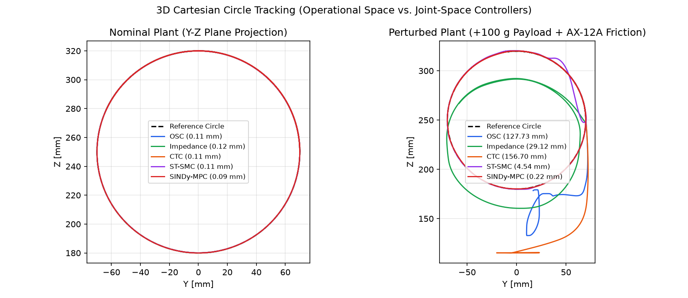
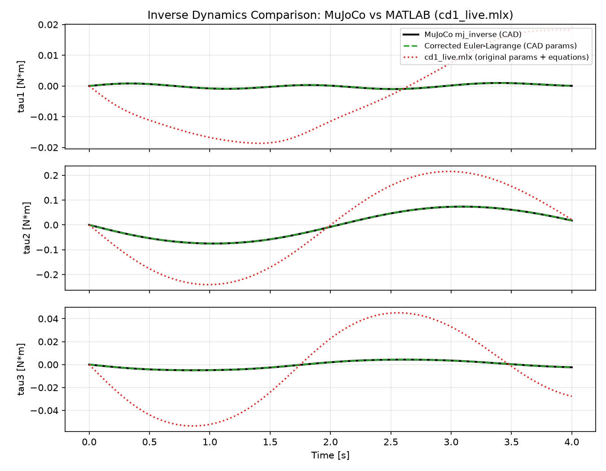

# 3-DOF Dynamixel AX-12A Serial Robot in MuJoCo

MuJoCo implementation of a 3-DOF serial manipulator (built with ROBOTIS Dynamixel AX-12A servos and FP04 brackets), converted directly from a SolidWorks / Simscape Multibody assembly (`Ensamble_SWML.xml` + `Ensamble_SWML_DataFile.m`) with exact link transforms, SolidWorks mass/inertia tensors, watertight CAD meshes, and verified analytical kinematics & Euler–Lagrange dynamics.

<p align="center">
  
  
</p>

## Highlights

- **Exact CAD geometry & inertia**: All 13 SolidWorks parts converted to watertight `.obj` meshes in meters (`meshes/`), with per-link `<inertial>` tensors computed via the parallel axis theorem from exact SolidWorks mass properties (total mass `207.41 g`).
- **Upright zero convention (`q = [0, 0, 0]`)**: At zero joint angles, the arm stands vertically along `+Z` with the base plate flush at `z = 0` and the `end_effector` site at `[0, 0, 0.496] m`.
- **Two actuation modes**:
  - **Torque-controlled (`model.xml` / `scene.xml`)**: Zero-damping `<motor>` actuators (`±1.5 N·m`) ideal for dynamics analysis, computed-torque control, and system identification (SINDy).
  - **Dynamixel AX-12A position-controlled (`model_ax12a.xml` / `scene_ax12a.xml`)**: `<position>` servos (`kp=10`, `kv=0.25`, `±1.5 N·m` stall torque) with 254:1 gearbox dynamics (`armature=0.003`, `damping=0.24`, `frictionloss=0.03`), matching the 12 V AX-12A no-load speed (`~59 RPM`).
- **Verified analytical model**: Symbolic & numerical Denavit–Hartenberg kinematics and Euler–Lagrange dynamics in both Python (`kinematics_dynamics_model.py`) and MATLAB (`matlab/cd1_corrected.m`), cross-checked against MuJoCo (`0.000 mm` FK error, `< 6e-5 N·m` inverse dynamics error).
- **Modular controller suite, Physics-Informed SINDy & LTV-MPC**: 12 joint-space and Cartesian controllers (`PID`, `PD+G`, `CTC`, `Slotine–Li Adaptive`, `SMC-BL`, `Super-Twisting SMC`, `Sugeno Fuzzy+G` ported from `sugenotype1_serial3.fis`, `Operational Space Control`, `Cartesian Impedance`, `LTV-MPC`, `SINDy+CTC`, and `SINDy-MPC`) benchmarked on both nominal and perturbed (`+100 g` payload, `+25%` mass mismatch, AX-12A gearbox friction, torque impulse) plants.

---

## Quick Start

### 1. Install Dependencies
```bash
python3 -m venv .venv
source .venv/bin/activate
pip install -r requirements.txt
```

### 2. Launch the Interactive 3D Viewer (with Live Joint Angle Sliders)
```bash
# AX-12A position-controlled robot: open right sidebar (Shift+Tab) -> Control
python -m mujoco.viewer --mjcf=scene_ax12a.xml
```
Or launch the torque-controlled model (press `Space` to pause, then drag sliders in **Joint**):
```bash
python -m mujoco.viewer --mjcf=scene.xml
```

### 3. Move From Home to Any Target Pose
```bash
# Joint-space move (radians): home [0, 0, 0] -> target [1.0, -0.6, 0.8]
python move_to_position.py --home 0 0 0 --target 1.0 -0.6 0.8 --duration 2.5

# Joint-space move (degrees)
python move_to_position.py --deg --home 0 0 0 --target 60 -35 45 --duration 2.5

# Cartesian end-effector target [x, y, z] in meters (automatic MuJoCo Jacobian IK)
python move_to_position.py --home 0 0 0 --xyz 0.20 0.15 0.30 --duration 2.5
```

### 4. Run Dynamics, Tracking & Verification Demos
```bash
# Computed-torque trajectory tracking in the 3D viewer
python run_demo.py --mode viewer

# Headless computed-torque tracking (saves renders/trajectory_tracking.png)
python run_demo.py --mode pd

# Print M(q), C(q,qd)*qd + G(q), inverse dynamics, and Jacobian J(q)
python run_demo.py --mode dynamics

# Verify physics (mass, gravity equilibrium, forward<->inverse round-trip, RK4 energy conservation)
python validate_simscape.py

# Symbolic Euler-Lagrange derivation + 100-state verification against MuJoCo
python kinematics_dynamics_model.py

# Compare MuJoCo against analytical model and export mujoco_comparison.mat
python compare_matlab_model.py
```

### 5. Run SINDy Identification, MPC & the 12-Controller Benchmark
```bash
# Discover sparse inverse-dynamics equations on the perturbed plant (or pass --matlab-dir ..)
python sindy_id.py --scenario perturbed

# Run full nominal, perturbed (+100 g payload + AX-12A friction + impulse), and 3D circle benchmarks
python benchmark_controllers.py

# Watch any controller live in the interactive 3D viewer (green sphere = live target)
python benchmark_controllers.py --viewer --controller sindy_mpc --scenario perturbed
python benchmark_controllers.py --viewer --controller st_smc --scenario perturbed
python benchmark_controllers.py --viewer --controller osc --trajectory circle
```
Available `--controller` options: `pid`, `pdg`, `ctc`, `adaptive`, `smc`, `st_smc`, `fuzzy`, `osc`, `impedance`, `mpc`, `sindy_ctc`, `sindy_mpc`.

---

## Controller Benchmark Summary

All nominal model-based controllers use **only** `CAD_PARAMS` (independent of MuJoCo internals), while `SINDy+CTC` and `SINDy-MPC` identify a sparse dynamic model automatically from a 12 s excitation rollout on the plant. All controllers enforce the AX-12A `±1.5 N·m` torque limit (`LTV-MPC` / `SINDy-MPC` also enforce slew-rate, joint-angle, and 59 RPM velocity constraints inside an ADMM QP).

| Controller | Space | Nominal EE RMSE | Perturbed EE RMSE | Perturbed Last 2 s | Smoothness (`Nominal` / `Perturbed`) |
| :--- | :--- | :---: | :---: | :---: | :---: |
| **SINDy-MPC + DOB (`sindy_mpc`)** | joint | `0.45 mm` | **`0.95 mm`** | **`0.27 mm`** | `0.03` / `0.53 N·m/s` |
| **Super-Twisting SMC (`st_smc`)** | joint | `0.26 mm` | **`1.58 mm`** | **`0.53 mm`** | `0.03` / `0.71 N·m/s` |
| **Slotine–Li Adaptive (`adaptive`)** | joint | `0.26 mm` | **`2.74 mm`** | **`2.11 mm`** | `0.03` / `0.76 N·m/s` |
| **SINDy + CTC (`sindy_ctc`)** | joint | `1.57 mm` | **`2.92 mm`** | **`0.40 mm`** | `0.03` / `0.58 N·m/s` |
| **Sliding Mode — Boundary Layer (`smc`)** | joint | `0.26 mm` | `9.80 mm` | `9.55 mm` | `0.03` / `0.64 N·m/s` |
| **PID Anti-Windup (`pid`)** | joint | `1.92 mm` | `28.47 mm` | `25.95 mm` | `0.05` / `0.61 N·m/s` |
| **Cartesian Impedance (`impedance`)** | cartesian | `0.49 mm` | `31.88 mm` | `34.82 mm` | `0.03` / `0.43 N·m/s` |
| **Sugeno Fuzzy + G (`fuzzy`)** | joint | `7.70 mm` | `59.08 mm` | `70.63 mm` | `0.28` / `0.62 N·m/s` |
| **PD + Gravity (`pdg`)** | joint | `0.45 mm` | `75.80 mm` | `86.96 mm` | `0.03` / `0.49 N·m/s` |
| **Operational Space (`osc`)** | cartesian | `0.26 mm` | `199.53 mm` | `220.67 mm` | `0.03` / `0.38 N·m/s` |
| **Computed-Torque (`ctc`)** | joint | `0.26 mm` | `260.59 mm` | `275.23 mm` | `0.03` / `0.29 N·m/s` |
| **LTV-MPC — Nominal (`mpc`)** | joint | `0.26 mm` | `267.46 mm` | `274.64 mm` | `0.03` / `0.29 N·m/s` |

<p align="center">
  
</p>
<p align="center">
  
  
</p>

---

## Validation Summary

| Check | Result |
| :--- | :--- |
| Total mass vs. SolidWorks XML | Exact (`207.407 g`) |
| Forward ↔ Inverse dynamics round-trip (`mj_forward` ↔ `mj_inverse`) | Max error `3.47e-16 N·m` |
| RK4 free-swing energy conservation (`1.0 s`, zero damping) | Max drift `1.64e-9 J` |
| Analytical DH FK vs. MuJoCo (100 random poses) | Max error `0.000000 mm` |
| Analytical Jacobian $J_v$ vs. MuJoCo (100 random poses) | Max error `0.000000 m/rad` |
| Analytical Euler–Lagrange vs. MuJoCo `mj_inverse` (100 random states) | Max error `5.80e-5 N·m` |
| AX-12A large-slew terminal speed (`scene_ax12a.xml`) | `58.5 RPM` (spec: `~59 RPM`) |

<p align="center">
  
  
</p>

---

## Repository Structure

```text
.
├── model.xml                     # Pure reusable MuJoCo robot asset (torque motors)
├── scene.xml                     # Scene wrapper (floor, lighting, gravity) for model.xml
├── model_ax12a.xml               # Pure robot asset with AX-12A position servos & gearbox physics
├── scene_ax12a.xml               # Scene wrapper for model_ax12a.xml (live angle sliders)
├── meshes/                       # 13 watertight .obj CAD meshes in meters
├── simscape/                     # Source Simscape Multibody XML & DataFile used by build_model.py
│   ├── Ensamble_SWML.xml
│   └── Ensamble_SWML_DataFile.m
├── matlab/
│   ├── cd1_corrected.m           # Corrected symbolic MATLAB kinematics & dynamics script
│   └── sugenotype1_serial3.fis   # Source Sugeno Type-1 fuzzy inference system
├── controllers/                  # Modular controller package (fast NumPy dynamics + 12 controllers)
│   ├── base.py                   # Common BaseController & TrajectoryReference interface
│   ├── dynamics.py               # Closed-form FK, J_v, J_v_dot, M, C, G & Slotine-Li regressor Y
│   ├── trajectories.py           # SmoothJointTrajectory & CartesianCircleTrajectory (exact IK)
│   ├── classical.py              # PIDController (anti-windup) & PDGravityController
│   ├── nonlinear.py              # ComputedTorqueController & SlotineLiAdaptiveController
│   ├── robust.py                 # SlidingModeController (boundary layer) & SuperTwistingSMC
│   ├── fuzzy.py                  # SugenoFuzzyController (ported from sugenotype1_serial3.fis)
│   ├── cartesian.py              # OperationalSpaceController (OSC) & CartesianImpedanceController
│   ├── sindy.py                  # Physics-Informed SINDy (normalized STLSQ + SINDyDynamics)
│   └── mpc.py                    # Constrained LTV-MPC / SINDy-MPC (ADMM QP + disturbance observer)
├── sindy_id.py                   # Standalone SINDy identification CLI (MuJoCo or MATLAB .mat logs)
├── benchmark_controllers.py      # Headless 12-controller benchmark suite + interactive 3D viewer
├── build_model.py                # Reproducible MJCF generator from simscape/ files
├── validate_simscape.py          # Physics verification & pose renderer
├── run_demo.py                   # Interactive viewer, computed-torque PD, replay & dynamics demos
├── move_to_position.py           # Point-to-point minimum-jerk mover (joint vector or XYZ IK)
├── kinematics_dynamics_model.py  # Clean SymPy + NumPy analytical model + MuJoCo cross-check
├── compare_matlab_model.py       # Side-by-side MuJoCo vs. MATLAB comparison & .mat exporter
├── KINEMATICS_DYNAMICS.md        # Full mathematical derivation & frame alignment guide
├── mujoco_comparison.mat         # Exported MuJoCo trajectory for loading directly in MATLAB
├── renders/                      # Verification renders and comparison plots
├── requirements.txt
├── LICENSE
└── README.md
```

For the full mathematical derivation (DH frames, Craig velocity propagation, Euler–Lagrange equations, Christoffel symbols, and CAD frame alignment), see [`KINEMATICS_DYNAMICS.md`](KINEMATICS_DYNAMICS.md).
