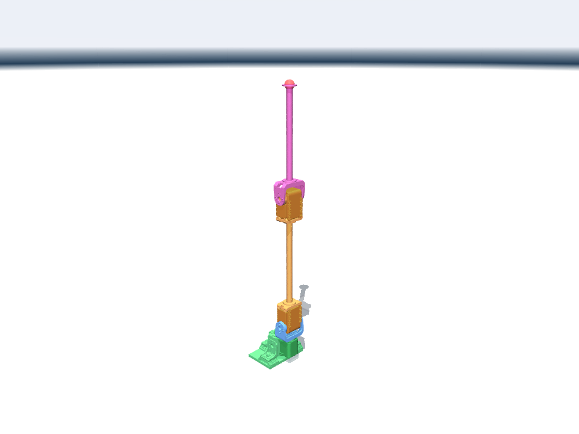
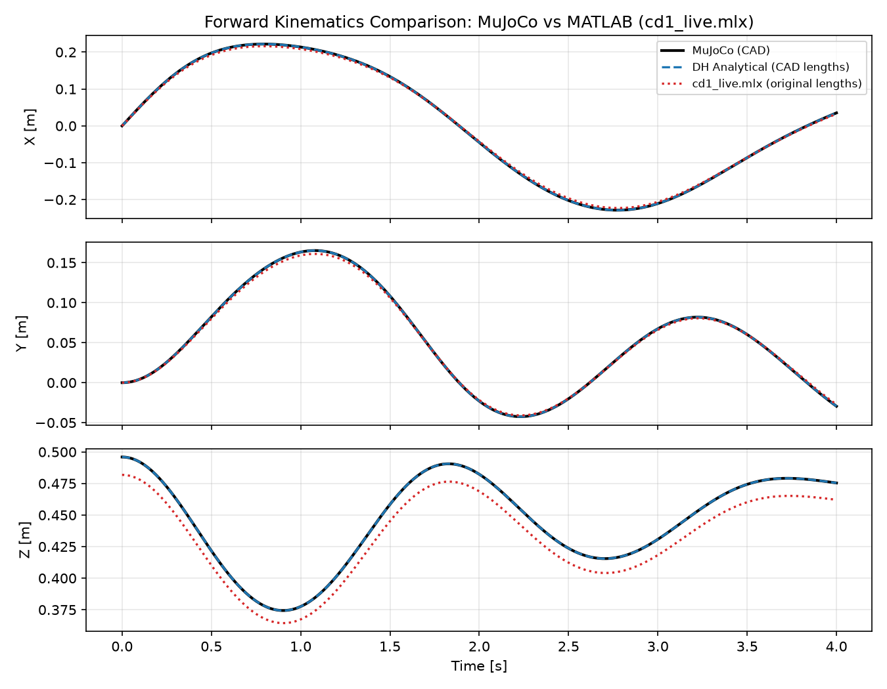

# 3-DOF Dynamixel AX-12A Serial Robot in MuJoCo

MuJoCo implementation of a 3-DOF serial manipulator (built with ROBOTIS Dynamixel AX-12A servos and FP04 brackets), converted directly from a SolidWorks / Simscape Multibody assembly (`Ensamble_SWML.xml` + `Ensamble_SWML_DataFile.m`) with exact link transforms, SolidWorks mass/inertia tensors, watertight CAD meshes, and verified analytical kinematics & Euler–Lagrange dynamics.

<p align="center">
  
  
</p>

## Highlights

- **Exact CAD geometry & inertia**: All 13 SolidWorks parts converted to watertight `.obj` meshes in meters (`meshes/`), with per-link `<inertial>` tensors computed via the parallel axis theorem from exact SolidWorks mass properties (total mass `207.41 g`).
- **Upright zero convention (`q = [0, 0, 0]`)**: At zero joint angles, the arm stands vertically along `+Z` with the base plate flush at `z = 0` and the `end_effector` site at `[0, 0, 0.496] m`.
- **Two actuation modes**:
  - **Torque-controlled (`model.xml` / `scene.xml`)**: Zero-damping `<motor>` actuators (`±1.5 N·m`) ideal for dynamics analysis, computed-torque control, and system identification (SINDy).
  - **Dynamixel AX-12A position-controlled (`model_ax12a.xml` / `scene_ax12a.xml`)**: `<position>` servos (`kp=10`, `kv=0.25`, `±1.5 N·m` stall torque) with 254:1 gearbox dynamics (`armature=0.003`, `damping=0.24`, `frictionloss=0.03`), matching the 12 V AX-12A no-load speed (`~59 RPM`).
- **Verified analytical model**: Symbolic & numerical Denavit–Hartenberg kinematics and Euler–Lagrange dynamics in both Python (`kinematics_dynamics_model.py`) and MATLAB (`matlab/cd1_corrected.m`), cross-checked against MuJoCo (`0.000 mm` FK error, `< 6e-5 N·m` inverse dynamics error).

---

## Quick Start

### 1. Install Dependencies
```bash
python3 -m venv .venv
source .venv/bin/activate
pip install -r requirements.txt
```

### 2. Launch the Interactive 3D Viewer (with Live Joint Angle Sliders)
```bash
# AX-12A position-controlled robot: open right sidebar (Shift+Tab) -> Control
python -m mujoco.viewer --mjcf=scene_ax12a.xml
```
Or launch the torque-controlled model (press `Space` to pause, then drag sliders in **Joint**):
```bash
python -m mujoco.viewer --mjcf=scene.xml
```

### 3. Move From Home to Any Target Pose
```bash
# Joint-space move (radians): home [0, 0, 0] -> target [1.0, -0.6, 0.8]
python move_to_position.py --home 0 0 0 --target 1.0 -0.6 0.8 --duration 2.5

# Joint-space move (degrees)
python move_to_position.py --deg --home 0 0 0 --target 60 -35 45 --duration 2.5

# Cartesian end-effector target [x, y, z] in meters (automatic MuJoCo Jacobian IK)
python move_to_position.py --home 0 0 0 --xyz 0.20 0.15 0.30 --duration 2.5
```

### 4. Run Dynamics, Tracking & Verification Demos
```bash
# Computed-torque trajectory tracking in the 3D viewer
python run_demo.py --mode viewer

# Headless computed-torque tracking (saves renders/trajectory_tracking.png)
python run_demo.py --mode pd

# Print M(q), C(q,qd)*qd + G(q), inverse dynamics, and Jacobian J(q)
python run_demo.py --mode dynamics

# Verify physics (mass, gravity equilibrium, forward<->inverse round-trip, RK4 energy conservation)
python validate_simscape.py

# Symbolic Euler-Lagrange derivation + 100-state verification against MuJoCo
python kinematics_dynamics_model.py

# Compare MuJoCo against analytical model and export mujoco_comparison.mat
python compare_matlab_model.py
```

---

## Validation Summary

| Check | Result |
| :--- | :--- |
| Total mass vs. SolidWorks XML | Exact (`207.407 g`) |
| Forward ↔ Inverse dynamics round-trip (`mj_forward` ↔ `mj_inverse`) | Max error `3.47e-16 N·m` |
| RK4 free-swing energy conservation (`1.0 s`, zero damping) | Max drift `1.64e-9 J` |
| Analytical DH FK vs. MuJoCo (100 random poses) | Max error `0.000000 mm` |
| Analytical Jacobian $J_v$ vs. MuJoCo (100 random poses) | Max error `0.000000 m/rad` |
| Analytical Euler–Lagrange vs. MuJoCo `mj_inverse` (100 random states) | Max error `5.80e-5 N·m` |
| AX-12A large-slew terminal speed (`scene_ax12a.xml`) | `58.5 RPM` (spec: `~59 RPM`) |

<p align="center">
  
  
</p>

---

## Repository Structure

```text
.
├── model.xml                     # Pure reusable MuJoCo robot asset (torque motors)
├── scene.xml                     # Scene wrapper (floor, lighting, gravity) for model.xml
├── model_ax12a.xml               # Pure robot asset with AX-12A position servos & gearbox physics
├── scene_ax12a.xml               # Scene wrapper for model_ax12a.xml (live angle sliders)
├── meshes/                       # 13 watertight .obj CAD meshes in meters
├── simscape/                     # Source Simscape Multibody XML & DataFile used by build_model.py
│   ├── Ensamble_SWML.xml
│   └── Ensamble_SWML_DataFile.m
├── matlab/
│   └── cd1_corrected.m           # Corrected symbolic MATLAB kinematics & dynamics script
├── build_model.py                # Reproducible MJCF generator from simscape/ files
├── validate_simscape.py          # Physics verification & pose renderer
├── run_demo.py                   # Interactive viewer, computed-torque PD, replay & dynamics demos
├── move_to_position.py           # Point-to-point minimum-jerk mover (joint vector or XYZ IK)
├── kinematics_dynamics_model.py  # Clean SymPy + NumPy analytical model + MuJoCo cross-check
├── compare_matlab_model.py       # Side-by-side MuJoCo vs. MATLAB comparison & .mat exporter
├── KINEMATICS_DYNAMICS.md        # Full mathematical derivation & frame alignment guide
├── mujoco_comparison.mat         # Exported MuJoCo trajectory for loading directly in MATLAB
├── renders/                      # Verification renders and comparison plots
├── requirements.txt
├── LICENSE
└── README.md
```

For the full mathematical derivation (DH frames, Craig velocity propagation, Euler–Lagrange equations, Christoffel symbols, and CAD frame alignment), see [`KINEMATICS_DYNAMICS.md`](KINEMATICS_DYNAMICS.md).
